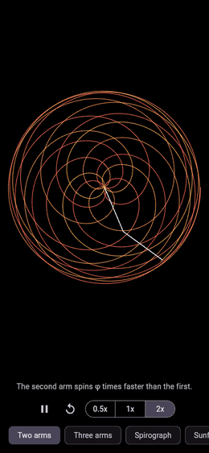

# Flutter Golden Ratio Visualization

Ten animated patterns built from the golden ratio, φ ≈ 1.618.

**Live demo: https://sharmadhiraj.github.io/Flutter-Golden-Ratio-Visualization/**

## Did you know?

φ is the "most irrational" number. Its continued fraction is all 1s, so no fraction approximates it
well. That is why a sunflower turns each new seed by 137.5° (the golden angle): the seeds never line
up in rows and pack as tightly as possible.

## Patterns

Two arms, Three arms, Spirograph, Sunflower, Spiral, Arcs, Rose, Weave, Star and Chords.

Tap the canvas to pause or resume. Use the buttons to replay and change speed.

## Code

- `lib/math`: φ, the golden angle and polar coordinates.
- `lib/patterns`: each pattern generates its points. To add one, extend `Pattern` and list it in
  `pattern_catalog.dart`.
- `lib/rendering`: one painter draws any pattern.
- `lib/screens`: the screen, playback controls and pattern chips.

No packages needed. Run `flutter test` for the tests.
